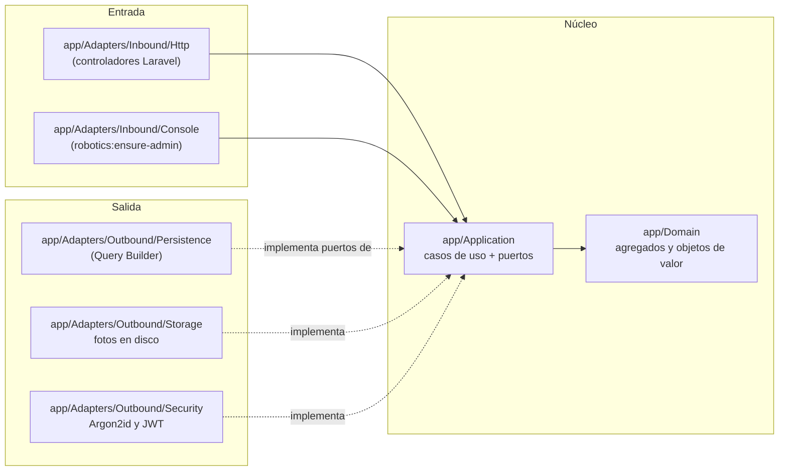
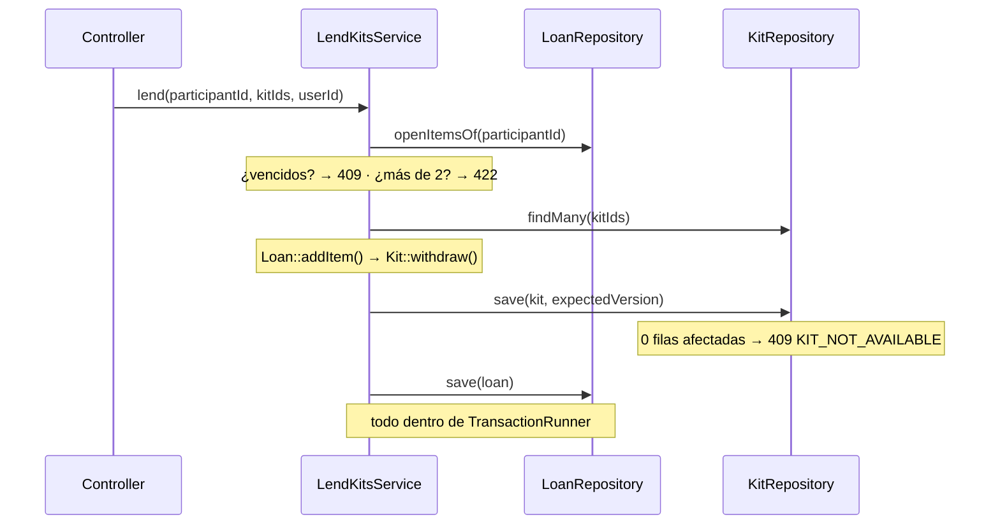
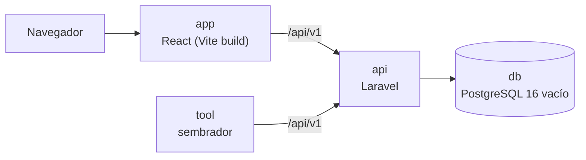

# Arquitectura — Robotics

Arquitectura **hexagonal** (puertos y adaptadores): las reglas del préstamo de kits viven en el centro y no saben que existen
Laravel, PostgreSQL ni HTTP. Los principios que la sostienen están en [`constitution.md`](constitution.md) (artículos I a IV).

## 1. Capas y dependencias



Las flechas solo apuntan hacia el centro. `app/Providers/PortBindingsServiceProvider.php` es el **único punto de composición**
(artículo III): ahí cada puerto se enlaza con su adaptador.

## 2. Estructura de carpetas (`api/`)

```text
app/
├── Domain/                 # PHP puro: sin Illuminate\, sin paquetes de vendor
│   ├── Kit.php  Loan.php  LoanItem.php  Participant.php  User.php  LoanStatus.php  Role.php
│   ├── ValueObjects/       # KitReference, Units, DocumentNumber, DateRange
│   └── Errors/             # DomainError + KitNotAvailable, ParticipantHasOverdue, ParticipantLimitExceeded, ...
├── Application/
│   ├── Ports/              # KitRepository, LoanRepository, ParticipantRepository, UserRepository, CategoryRepository,
│   │                       # ReportReader, Clock, PasswordHasher, TokenIssuer, PhotoStorage, TransactionRunner
│   └── Services/           # LoginService, CreateMentorService, CreateKitService, UpdateKitService, RemoveKitService,
│                           # SearchKitsService, KitPhotoService, CreateParticipantService,
│                           # SearchParticipantsService, LendKitsService, ReturnItemService, GetLoanService,
│                           # ListLoansService, OverdueService, MostRequestedReportService
├── Adapters/
│   ├── Inbound/Http/       # Controllers, Middleware (JWT, rol), ApiErrorRenderer
│   ├── Inbound/Console/    # EnsureAdminCommand
│   └── Outbound/           # Persistence/, Storage/, Security/, SystemClock
└── Providers/PortBindingsServiceProvider.php
database/migrations/        # Todo el DDL y la semilla de categorías (ADR-001)
tests/Unit/Domain  tests/Unit/Application  tests/Architecture  tests/Feature  tests/Integration
```

## 3. Agregados

| Agregado | Invariantes que protege |
|---|---|
| `Kit` | Disponibles entre 0 y total; total ≥ 1; referencia `AAA-0000`; `withdraw()` falla sin unidades; `restock()` nunca supera el total; baja lógica solo sin préstamos abiertos |
| `Loan` | 1 a 2 líneas, sin kits repetidos; `due_at = loaned_at + 12 días`; congela nombre, referencia y categoría; inmutable salvo devolver una línea; estado calculado con el `Clock` |
| `Participant` | Nombre y documento obligatorios; documento normalizado |
| `User` | Nombre en minúsculas y recortado; rol `admin` o `mentor` |

`Loan::addItem()` llama a `Kit::withdraw()` antes de añadir la línea; `Loan::returnItem()` llama a `Kit::restock()` una sola vez por línea.
Las reglas que miran varios préstamos (máximo 2 sin devolver, vencidos) las aplica `LendKitsService` con datos que le da `LoanRepository`.

## 4. Flujo de un préstamo



## 5. Errores

El dominio lanza `DomainError` con su `code` (`KIT_NOT_AVAILABLE`, …). **Solo** el adaptador HTTP (`ApiErrorRenderer`, registrado en
`bootstrap/app.php`) lo traduce al cuerpo único `{code, message, details}` y al estado HTTP de [`api-contract.md`](api-contract.md) §2.
Las excepciones de Laravel (validación, 404 de ruta, 401) también pasan por ahí: un error del framework nunca llega crudo al cliente.

## 6. Frontend (`app/`)

```text
src/
├── api/client.js        # fetch con Bearer token y lectura del cuerpo de error único
├── auth/                # contexto de sesión (token y rol)
└── pages/               # Login, Kits, Participants, NewLoan, Loans, Overdue, Report, Users
```

Las pantallas solo muestran lo que el rol puede hacer; **la autorización real la hace la API** (403).

## 7. Despliegue (`infra/`)



`docker compose up` levanta `db`, `api` y `app`. Al arrancar, `api` corre `migrate` y `robotics:ensure-admin`. `page` es estático y no
depende de ninguno.
