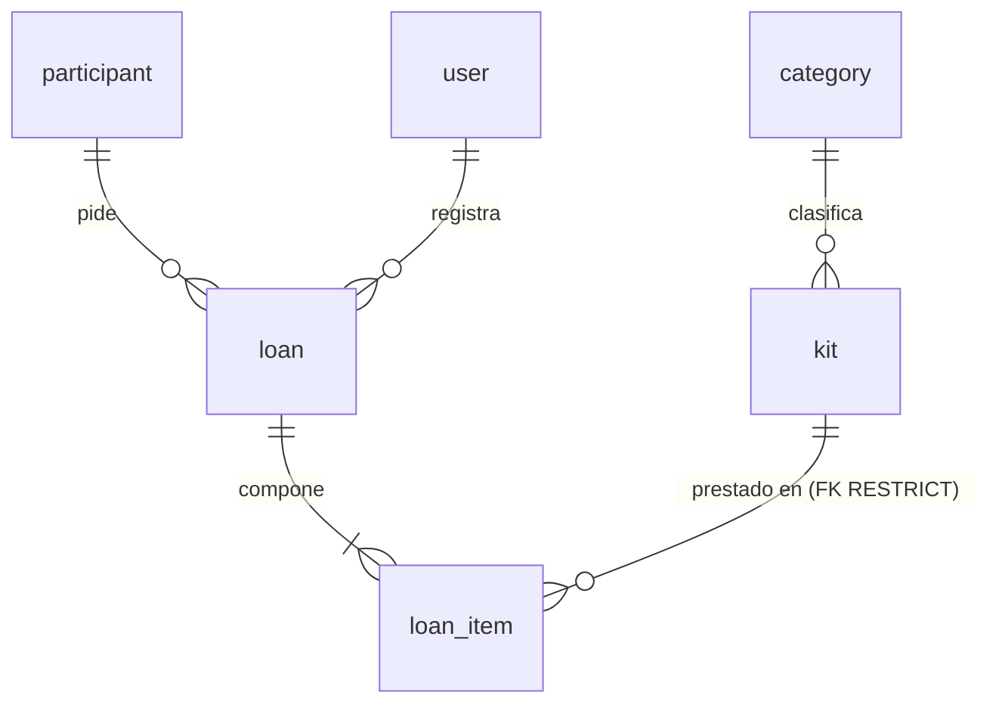

# Modelo de datos — Robotics

**El único sitio donde vive el modelo de datos.** Quien implemente no necesita abrir el código ni conectarse
al motor para saber qué hay, de qué tipo y con qué regla.

- Motor: PostgreSQL 16. Esquema `robotics`. Servidor en UTC.
- Rige bajo [`constitution.md`](constitution.md) y [`spec.md`](spec.md). Si el motor y este documento discrepan, gana el motor
  y se corrige este documento (artículo X).

Cada regla lleva una de **tres marcas**: **motor** (la impone la base), **solo dominio** (solo el código),
**pendiente (T-xx)** (la baja a la base esa tarea de [`tasks.md`](tasks.md)).

---

## 0. Convención de nombres

| Elemento | Convención | Ejemplo |
|---|---|---|
| Tabla | `snake_case`, inglés, **singular** | `loan_item` |
| Columna | `snake_case`, inglés, singular, ASCII | `due_at` |
| Clave primaria | `pk_{tabla}` | `pk_loan_item` |
| Clave foránea | `fk_{tabla}_{tabla referida}` | `fk_loan_item_kit` |
| Índice único | `uq_{tabla}_{columnas}` | `uq_kit_reference_active` |
| Índice de acceso | `ix_{tabla}_{columnas}` | `ix_loan_item_due_open` |
| Restricción escrita a mano | `ck_{tabla}_{regla}` | `ck_kit_available_range` |
| Esquema | `robotics` | `robotics.loan` |

`user` es palabra reservada: en SQL a mano se escribe `robotics."user"`.

## 1. Glosario

| Término | Definición | Dónde vive |
|---|---|---|
| **Kit** | Kit de robótica del catálogo: nombre, fabricante, referencia, categoría, unidades y foto opcional | `kit` |
| **Referencia** | Código del kit con formato `AAA-0000` | `kit.reference` |
| **Categoría** | Clasificación fija de cinco, sembrada, sin mantenimiento | `category` |
| **Unidad** | Ejemplar físico de un kit. Se cuenta, no se identifica | `kit.total_units`, `kit.available_units` |
| **Participante** | Persona del semillero que pide kits. No inicia sesión | `participant` |
| **Préstamo** | Hecho consumado: quién lo pidió, quién lo registró y cuándo | `loan` |
| **Línea de préstamo** | Un kit dentro de un préstamo, con su vencimiento y su devolución | `loan_item` |
| **Estado del préstamo** | `open`, `overdue` o `closed`. **Se calcula, no se almacena** | sin columna |
| **Usuario** | Operador interno con rol `admin` o `mentor` | `user` |
| **Congelado** | Copia del valor en el instante del préstamo; no sigue al catálogo | `loan_item.kit_name`, `kit_reference`, `category_name` |

## 2. Entidades y relaciones



**Seis entidades, seis tablas** en el esquema `robotics`. No hay tabla de reporte, de multas ni de auditoría.
La tabla de control `migrations` de Laravel vive en el esquema `public`, fuera de `robotics`.

## 3. Modelo físico

Ninguna columna lleva `DEFAULT`: los valores los pone el dominio.

**`category`** — semilla de solo lectura.

| Columna | Tipo | Nulable | Nota |
|---|---|---|---|
| `id` | `uuid` | no | PK. Identificadores fijos (ver §9) |
| `name` | `varchar(120)` | no | Único |

**`kit`**

| Columna | Tipo | Nulable | Nota |
|---|---|---|---|
| `id` | `uuid` | no | PK |
| `name` | `varchar(200)` | no | Recortado por el dominio |
| `manufacturer` | `varchar(150)` | no | |
| `reference` | `char(8)` | no | Formato `AAA-0000`. Único entre kits activos (índice parcial) |
| `category_id` | `uuid` | no | FK restrictiva a `category` |
| `total_units` | `integer` | no | ≥ 1 |
| `available_units` | `integer` | no | Entre 0 y `total_units` |
| `photo_key` | `varchar(512)` | **sí** | Clave opaca; nunca ruta ni bytes; nunca cadena vacía |
| `version` | `integer` | no | Testigo de concurrencia optimista: 1 al crear, +1 en cada escritura ([ADR-002](adr/adr-002-concurrencia-optimista.md)) |
| `deleted_at` | `timestamptz` | sí | Baja lógica. Nula = activo ([ADR-003](adr/adr-003-baja-logica.md)) |

**`participant`**

| Columna | Tipo | Nulable | Nota |
|---|---|---|---|
| `id` | `uuid` | no | PK |
| `full_name` | `varchar(200)` | no | |
| `document_number` | `varchar(30)` | no | Único |

**`loan`**

| Columna | Tipo | Nulable | Nota |
|---|---|---|---|
| `id` | `uuid` | no | PK |
| `participant_id` | `uuid` | no | FK restrictiva a `participant` |
| `loaned_by_user_id` | `uuid` | no | FK restrictiva a `user` |
| `loaned_at` | `timestamptz` | no | Instante del préstamo |

**`loan_item`**

| Columna | Tipo | Nulable | Nota |
|---|---|---|---|
| `id` | `uuid` | no | PK |
| `loan_id` | `uuid` | no | FK con `ON DELETE CASCADE` |
| `kit_id` | `uuid` | no | FK restrictiva a `kit` |
| `kit_name` | `varchar(200)` | no | Congelado; mismo ancho que `kit.name` |
| `kit_reference` | `char(8)` | no | Congelado |
| `category_name` | `varchar(120)` | no | Congelado; **sin FK a propósito** |
| `due_at` | `timestamptz` | no | `loaned_at` + 12 días, calculado por el dominio |
| `returned_at` | `timestamptz` | **sí** | Nula mientras no se devuelve |

**`user`**

| Columna | Tipo | Nulable | Nota |
|---|---|---|---|
| `id` | `uuid` | no | PK |
| `username` | `varchar(120)` | no | Único, minúsculas, recortado |
| `password_hash` | `varchar(512)` | no | Argon2id. Nunca se indexa |
| `role` | `varchar(40)` | no | `admin` o `mentor` |

Reglas transversales: **todas las marcas de tiempo son `timestamptz`**; **no hay columnas de auditoría** (`created_at`/`updated_at`)
porque ningún requisito las pide.

## 4. Restricciones e índices: dónde vive cada regla

| Regla | Objeto | Marca |
|---|---|---|
| Claves primarias de las seis tablas | `pk_*` | **motor** |
| `category.name` único | índice único | **motor** |
| `participant.document_number` único | índice único | **motor** |
| `user.username` único | índice único | **motor** |
| `reference` única entre activos | índice único parcial `WHERE deleted_at IS NULL` | **motor** |
| `kit.category_id` → `category.id` RESTRICT | FK | **motor** |
| `loan.participant_id` → `participant.id` RESTRICT | FK | **motor** |
| `loan.loaned_by_user_id` → `user.id` RESTRICT | FK | **motor** |
| `loan_item.loan_id` → `loan.id` CASCADE | FK | **motor** |
| `loan_item.kit_id` → `kit.id` RESTRICT | FK | **motor** |
| `0 <= available_units <= total_units` | `ck_kit_available_range` | **motor** — última barrera de concurrencia (RN-1) |
| Único `(loan_id, kit_id)` | índice único | **motor** (CA-06.2) |
| `total_units >= 1` | `ck_kit_total_positive` | **motor** (T-18) y dominio (`Units`) |
| `role` en (`admin`, `mentor`) | `ck_user_role` | **motor** (T-18) y dominio (`Role`) |
| `reference` con formato `AAA-0000` | `ck_kit_reference_format` | **motor** (T-18) y dominio (`KitReference`) |
| Máximo 2 kits sin devolver por participante | — | **solo dominio** (no expresable en un `CHECK`) |
| Participante con vencidos no pide | — | **solo dominio** |
| Descontar unidad y crear línea son una operación | — | **solo dominio** (una transacción) |
| Un préstamo tiene 1 a 2 líneas | — | **solo dominio** |
| Préstamos y devoluciones inmutables salvo `returned_at` | — | **solo dominio** (por ausencia de operación) |

Índices de acceso: `kit (category_id, name)` parcial sobre activos; `loan (loaned_at)`; `loan (participant_id)`;
`loan_item (kit_id)`; `loan_item (due_at) WHERE returned_at IS NULL` para vencidos.

## 5. Política de claves foráneas

| # | FK | `ON DELETE` | Por qué |
|---|---|---|---|
| FK-1 | `kit.category_id` | RESTRICT | Una categoría con kits no se elimina |
| FK-2 | `loan_item.loan_id` | CASCADE | Composición: la línea no vive sin su préstamo (nunca se dispara: no se borran préstamos) |
| FK-3 | `loan_item.kit_id` | RESTRICT | Barrera de última instancia: un borrado manual no puede dejar huérfano el histórico |
| FK-4 | `loan.participant_id` | RESTRICT | El participante de un préstamo no desaparece |
| FK-5 | `loan.loaned_by_user_id` | RESTRICT | Quién registró el préstamo es un dato que se conserva |

`ON UPDATE NO ACTION` en todas: las claves son UUID generados por la aplicación y no cambian.

## 6. Patrones de acceso

| # | Patrón | Frecuencia |
|---|---|---|
| Q1 | Buscar kits (texto en nombre o fabricante, categoría, activos, orden por nombre, paginado) | Alta (RNF-1) |
| Q2 | Kit por id | Alta |
| Q3 | Kits por lote de ids (antes de prestar) | Alta, punto de contención (RNF-2) |
| Q4 | Listar categorías | Alta |
| Q5 | Préstamo con sus líneas | Media |
| Q6 | Préstamos por rango, estado y participante | Alta |
| Q7 | Líneas sin devolver de un participante (conteo y vencidos) | Alta, en cada préstamo |
| Q8 | Vencidos globales | Media |
| Q9 | Reporte: kits más solicitados por rango | Media, la más costosa |
| Q10 | Usuario por nombre | Alta, en cada inicio de sesión |

## 7. Privacidad y retención

| Tabla | Atributo | Clasificación | Manejo |
|---|---|---|---|
| `user` | `username` | Dato personal | Acceso restringido |
| `user` | `password_hash` | **Secreto** | Jamás en logs ni respuestas; nunca se indexa |
| `participant` | `full_name`, `document_number` | **Dato personal** | Solo `admin` y `mentor`; **nunca** en el reporte |
| `loan`, `loan_item` | todos | Operativos; `participant_id` es dato personal indirecto | Retención indefinida |
| `kit`, `category` | todos | Públicos | Baja lógica / sin borrado |

El reporte agrega por kit: **no expone participantes ni mentores** (CA-10.3).

**Retención:** préstamos y líneas nunca se borran; los kits solo tienen baja lógica; el binario de la foto es el **único** dato que se
borra físicamente. Orden obligatorio: primero se anula `photo_key` y se confirma la transacción; después se borra el archivo.

## 8. Auditoría

El sistema **no** lleva `created_at`/`updated_at`. Los instantes de negocio ya tienen columna: `loan.loaned_at`, `loan_item.returned_at`
y `kit.deleted_at`. Si aparece una pregunta del tipo «¿quién renombró este kit?», la decisión vuelve al spec (artículo XIII).

## 9. Estrategia de semilla

Las **cinco categorías** van en la migración inicial, con identificadores fijos:

| `id` | `name` |
|---|---|
| `11111111-1111-4111-8111-111111111111` | Iniciación |
| `22222222-2222-4222-8222-222222222222` | Sensores |
| `33333333-3333-4333-8333-333333333333` | Drones |
| `44444444-4444-4444-8444-444444444444` | Impresión 3D |
| `55555555-5555-4555-8555-555555555555` | Competencia |

El **administrador inicial no lo siembra la base**: lo crea el arranque de la aplicación con credenciales de entorno, porque el hash
solo puede producirlo el puerto `PasswordHasher`. El sembrador de demostración (`tool`) usa la **API**, nunca SQL directo.

## 10. Cómo se comprueba que este documento no miente

```sql
-- Debe devolver exactamente las seis tablas de §3
SELECT table_name FROM information_schema.tables WHERE table_schema = 'robotics' ORDER BY 1;

-- Columnas de §3, sin ningún DEFAULT (column_default debe salir NULL en todas)
SELECT table_name, ordinal_position, column_name, data_type, is_nullable, column_default
FROM information_schema.columns WHERE table_schema = 'robotics' ORDER BY 1, 2;

-- Restricciones: PK, FK, UNIQUE y CHECK
SELECT c.conrelid::regclass, c.conname, c.contype, pg_get_constraintdef(c.oid)
FROM pg_constraint c JOIN pg_namespace n ON n.oid = c.connamespace
WHERE n.nspname = 'robotics' ORDER BY 1, 3, 2;

-- Índices
SELECT tablename, indexname, indexdef FROM pg_indexes WHERE schemaname = 'robotics' ORDER BY 1, 2;

-- Las cinco categorías
SELECT id, name FROM robotics.category ORDER BY name;
```

Si una regla marcada **motor** no aparece, alguien la borró. Si una marcada **solo dominio** o **pendiente** aparece, ya se bajó y hay
que reclasificarla aquí.
